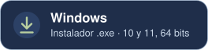
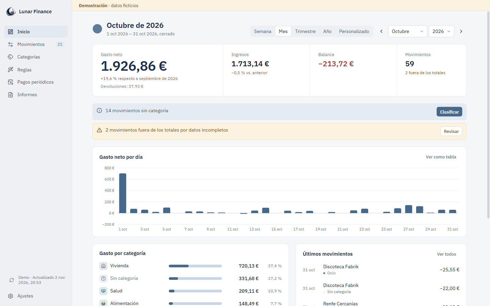
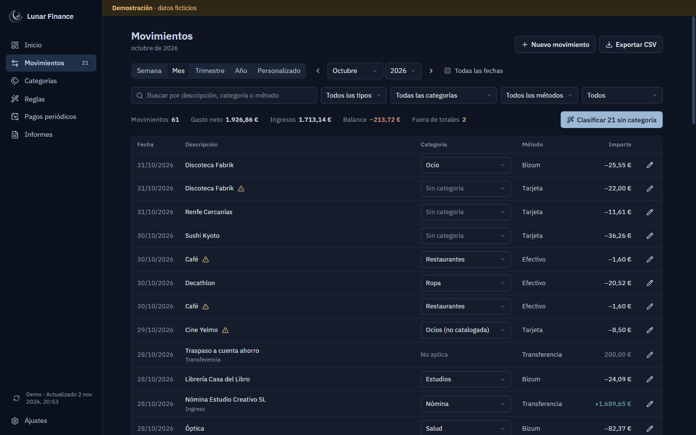
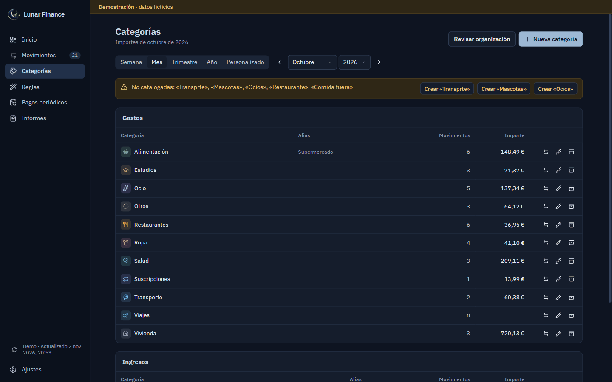
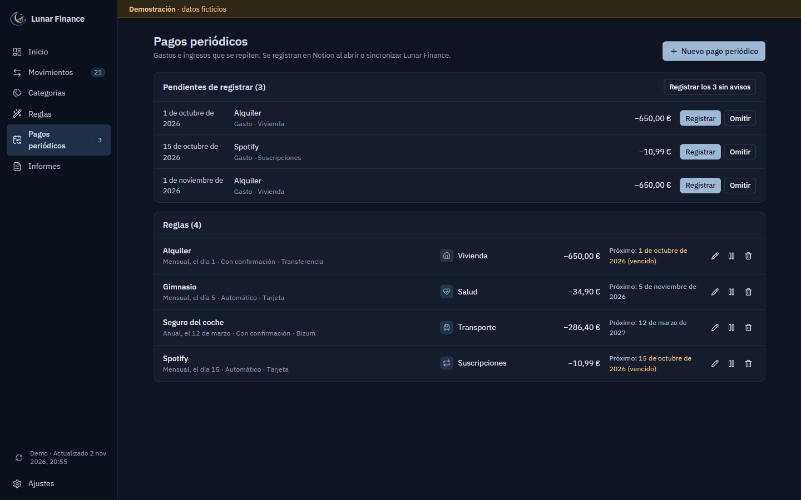
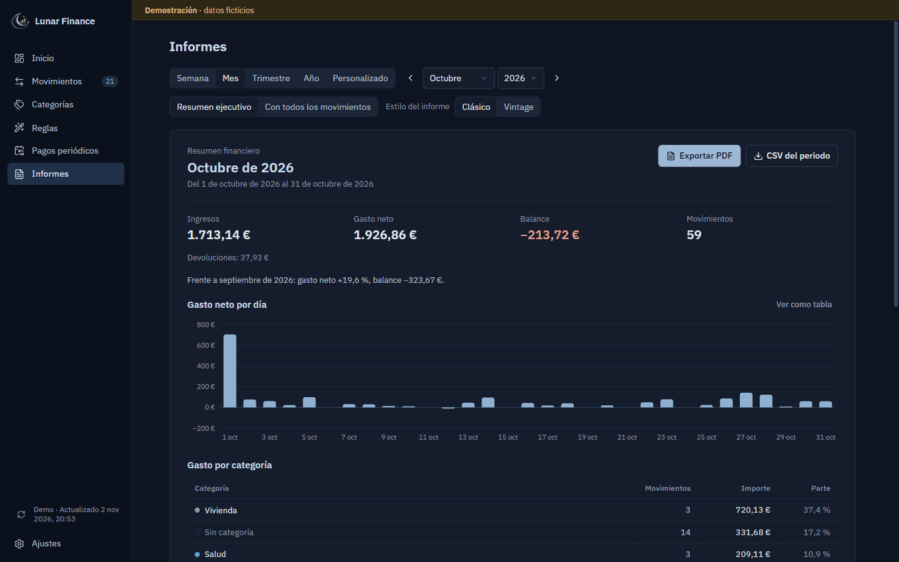
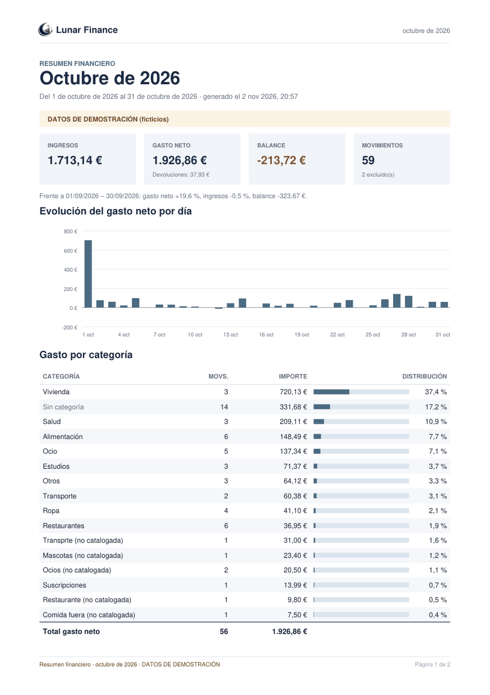
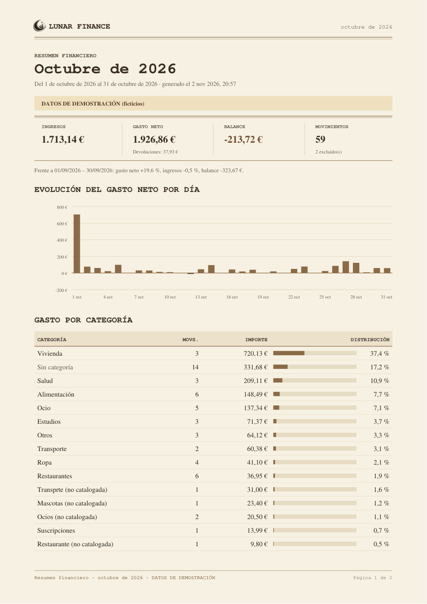

<div align="center">


# Lunar Finance

### Claridad para tus gastos

Tus movimientos de Notion, convertidos en un panel de finanzas personales con informes PDF,<br>
categorías automáticas, pagos periódicos e IA local. Para Windows y Linux.

<a href="https://github.com/DiegoHA17/lunar-finance/releases/download/v0.3.0/Lunar-Finance_0.3.0_x64-setup.exe"></a>
<a href="https://github.com/DiegoHA17/lunar-finance/releases/download/v0.3.0/Lunar-Finance_0.3.0_amd64.deb"></a>
<br>
<a href="https://github.com/DiegoHA17/lunar-finance/releases/download/v0.3.0/Lunar-Finance_0.3.0_amd64.AppImage"></a>
<a href="https://github.com/DiegoHA17/lunar-finance/releases/download/v0.3.0/Lunar-Finance-0.3.0-1.x86_64.rpm"></a>

**Versión 0.3.0** · [Todas las versiones](https://github.com/DiegoHA17/lunar-finance/releases) · [Cómo instalar](#instalación) · [SHA-256](https://github.com/DiegoHA17/lunar-finance/releases/download/v0.3.0/SHA256SUMS.txt)

[](#instalación)
[](LICENSE)

[Vídeo](#vídeo-de-presentación) · [Capturas](#capturas) · [Funcionalidades](#funcionalidades) · [Notion](#conectar-con-notion) · [Atajos de iPhone](#atajos-de-iphone) · [Documentación](docs/README.md)

</div>

<picture>
  <source media="(prefers-color-scheme: dark)" srcset="assets/readme/inicio-oscuro.png">
  
</picture>

## Qué es Lunar Finance

**El problema.** Notion es muy cómodo para apuntar gastos, también desde el móvil, pero responder a «¿cuánto he
gastado este mes y en qué?» exige montar vistas, filtros y fórmulas para cada pregunta. Y un PDF presentable de tus
finanzas no sale solo.

**La solución.** Lunar Finance es una aplicación de escritorio que lee tu base de datos de gastos de Notion y la
convierte en:

- un panel claro con gasto neto, ingresos y balance;
- categorías ordenadas y reglas que clasifican solas;
- pagos periódicos que se registran sin duplicados;
- informes PDF listos para guardar o imprimir.

Tus datos se quedan en tu Notion: Lunar Finance no tiene servidor ni cuentas propias. El token se guarda en el almacén
seguro del sistema y la IA opcional funciona en tu equipo.

## Vídeo de presentación

<a href="https://github.com/DiegoHA17/lunar-finance/releases/download/v0.3.0/Lunar-Finance-presentacion.mp4"></a>

<p align="center">
  <a href="https://github.com/DiegoHA17/lunar-finance/releases/download/v0.3.0/Lunar-Finance-presentacion.mp4"><b>▶ Ver el vídeo</b></a> · MP4, 2 min, 17 MB
</p>

Un recorrido por la aplicación: panel, movimientos, categorías, reglas, informes PDF, ajustes e IA local. Está grabado
con la versión 0.2.0, así que no muestra el estilo Vintage ni los pagos periódicos. [Créditos del vídeo](#créditos-del-vídeo).

## Capturas

| Movimientos | Categorías |
| --- | --- |
|  |  |
| **Pagos periódicos** | **Informes** |
|  |  |

| Informe PDF · Clásico | Informe PDF · Vintage |
| --- | --- |
|  |  |

<sub>Capturas de la aplicación real en modo demostración, con datos ficticios.</sub>

## Funcionalidades

| Área | Qué hace |
| --- | --- |
| 📊 **Panel** | Gasto neto, ingresos, balance y movimientos de la semana, el mes, el trimestre, el año o un intervalo propio. Comparación con el periodo anterior, evolución y gasto por categoría. |
| 🧾 **Movimientos** | Buscar, filtrar, crear, editar y corregir categorías. Los datos incompletos quedan fuera de los totales, con el motivo visible. Avisa de posibles duplicados. |
| 🏷️ **Categorías** | Catálogo en Notion con colores, iconos y alias. Se archivan sin perder el histórico. **Revisar organización** detecta erratas, plurales y duplicados. |
| ⚙️ **Reglas** | Clasificación automática por palabras, con prioridades, condiciones y excepciones. Crea reglas a partir de tus correcciones. |
| 📄 **Informes** | PDF en estilo **Clásico** o **Vintage**, en resumen ejecutivo o con todos los movimientos. Exportación a **CSV**. |
| 🔁 **Pagos periódicos** | Alquiler, suscripciones o nómina, semanales, mensuales o anuales. Se registran solos o tras tu confirmación, [sin duplicados](#pagos-periódicos). |
| 🤖 **IA local** | Opcional, con [Ollama](https://ollama.com): propone categorías y revisa la organización en tu equipo. Nada se aplica sin tu confirmación. |
| 🔒 **Privacidad** | Sin servidor propio ni analíticas. Token en el almacén seguro del sistema. Modo demostración con datos ficticios. |

> [!NOTE]
> La lectura de una base de Notion real está verificada. Las escrituras (crear y editar movimientos, aplicar
> categorías y registrar pagos periódicos) tienen pruebas automáticas contra una API simulada, pero aún no se han
> probado de forma controlada contra Notion real.

## Por qué lo desarrollé

Todo empezó viendo cómo mi compañera de piso apuntaba sus gastos en Notion. Pensé que también me serviría a mí y
empecé a hacerlo.

Me gustaba lo flexible que es Notion, pero con el uso diario eché en falta algo más directo:

- consultar mis movimientos de un vistazo;
- revisar las categorías;
- sacar informes en PDF;
- analizar en qué gasto, sin construir vistas y configuraciones para cada pregunta.

Así empecé Lunar Finance. Con el tiempo fui añadiendo los informes, la organización de categorías y la IA local con
Ollama. También preparé unos atajos de iPhone para apuntar gastos en Notion directamente desde el móvil.

— Diego

## Tecnologías


| Tecnología | Para qué se usa |
| --- | --- |
| [Tauri 2](https://tauri.app) | Aplicación de escritorio ligera e instaladores para Windows y Linux |
| [Rust](https://www.rust-lang.org) | Capa nativa: API de Notion, token, archivos locales y conexión con Ollama |
| [React 19](https://react.dev) + [TypeScript](https://www.typescriptlang.org) | Interfaz, cálculos financieros e informes |
| [Tailwind CSS 4](https://tailwindcss.com) | Estilos y temas claro y oscuro |
| [Notion API](https://developers.notion.com) | Única fuente de datos (versión `2026-03-11`) |
| [Ollama](https://ollama.com) | IA local opcional para proponer categorías |
| [pdf-lib](https://pdf-lib.js.org) | Informes PDF generados en el propio equipo |

## Instalación

| Sistema | Archivo | Tamaño |
| --- | --- | --- |
| **Windows** 10 y 11 (64 bits) | [Instalador `.exe`](https://github.com/DiegoHA17/lunar-finance/releases/download/v0.3.0/Lunar-Finance_0.3.0_x64-setup.exe) | 2,7 MB |
| **Ubuntu 22.04+ / Debian 12+** | [Paquete `.deb`](https://github.com/DiegoHA17/lunar-finance/releases/download/v0.3.0/Lunar-Finance_0.3.0_amd64.deb) | 3,7 MB |
| **Linux portable** | [AppImage](https://github.com/DiegoHA17/lunar-finance/releases/download/v0.3.0/Lunar-Finance_0.3.0_amd64.AppImage) | 80 MB |
| **Fedora / openSUSE** | [Paquete `.rpm`](https://github.com/DiegoHA17/lunar-finance/releases/download/v0.3.0/Lunar-Finance-0.3.0-1.x86_64.rpm) (sin probar en esas distribuciones) | 3,7 MB |

<details>
<summary><b>Windows</b></summary>

1. Abre `Lunar-Finance_0.3.0_x64-setup.exe`. Se instala para tu usuario, sin permisos de administrador.
2. El instalador no está firmado: si SmartScreen avisa, pulsa **Más información → Ejecutar de todas formas**.
3. Abre **Lunar Finance** desde el menú Inicio.

</details>

<details>
<summary><b>Ubuntu y Debian</b></summary>

```bash
sudo apt install ./Lunar-Finance_0.3.0_amd64.deb
```

</details>

<details>
<summary><b>AppImage (cualquier distribución)</b></summary>

```bash
chmod +x Lunar-Finance_0.3.0_amd64.AppImage
./Lunar-Finance_0.3.0_amd64.AppImage
```

Si no arranca, instala `libfuse2` (`libfuse2t64` en Ubuntu 24.04).

</details>

<details>
<summary><b>Fedora y openSUSE</b></summary>

```bash
sudo dnf install ./Lunar-Finance-0.3.0-1.x86_64.rpm
```

En openSUSE: `sudo zypper install ./Lunar-Finance-0.3.0-1.x86_64.rpm`.

</details>

En Linux, el token se guarda en GNOME Keyring o KWallet. No hay versión para macOS ni para ARM. Guía completa,
comprobación SHA-256 y desinstalación: **[docs/instalacion.md](docs/instalacion.md)**.

**Primer arranque:** elige **Ver demostración** para curiosear con datos ficticios, o **Conectar con Notion** para
usar los tuyos.

## Conectar con Notion

1. **Crea una integración** interna en [notion.so/profile/integrations](https://www.notion.so/profile/integrations)
   con permiso para leer, actualizar e insertar contenido.
2. **Dale acceso a tu base de datos de gastos:** en la base de datos, menú **···** → **Conexiones**.
3. **Pega el token** (`ntn_…`) en **Ajustes → Conexión con Notion**, elige la base de datos y revisa la asignación
   de propiedades.
4. **Ejecuta el diagnóstico** (Ajustes → Diagnóstico): si todo sale en verde, ya está.

La aplicación se adapta a los nombres de tus propiedades. Necesita, como mínimo, estas:

| Propiedad | Tipo en Notion |
| --- | --- |
| Descripción | Título |
| Fecha | Fecha |
| Cantidad | Número |
| Tipo (Gasto, Ingreso, Devolución o Transferencia) | Selección |
| Categoría | Selección |

«Método de Pago» es opcional. **[Guía paso a paso, pensada para quien nunca ha usado una integración →](docs/configuracion-notion.md)**

## IA local con Ollama

Es opcional y está desactivada por defecto.

1. Instala [Ollama](https://ollama.com/download).
2. Abre **Ajustes → Inteligencia artificial** y pulsa **Comprobar**.
3. Descarga el modelo que te propone la aplicación según tu memoria (por ejemplo, `gemma3:4b`). Pide confirmación
   antes de descargarlo.
4. Activa **Proponer categorías con IA**.

La IA solo elige entre tus categorías y nunca aplica nada sin tu confirmación. **[Guía de IA local →](docs/ia.md)**

## Pagos periódicos

Para gastos e ingresos que se repiten: alquiler, suscripciones, nómina…

- **Cada regla** tiene descripción, importe, categoría, tipo, método de pago, frecuencia (semanal, mensual o anual) y
  fecha del primer pago.
- **Registro automático:** los pagos vencidos se crean en Notion al abrir o sincronizar la aplicación. Los anteriores
  a la creación de la regla siempre piden confirmación.
- **Con confirmación:** aparecen en «Pendientes de registrar» hasta que los apruebes u omitas.
- **Sin duplicados:** cada pago lleva una clave única en la propiedad «Pago periódico», que la aplicación añade a tu
  base de datos con tu permiso. Antes de registrar, comprueba en Notion si ya existe. Si no puede saberlo con
  certeza, por ejemplo tras un corte de red, te pide que lo revises.
- **No toca el pasado:** editar, pausar o borrar una regla nunca modifica los movimientos ya registrados.

**[Cómo funcionan los pagos periódicos →](docs/pagos-periodicos.md)**

## Atajos de iPhone

Dos atajos de la app Atajos apuntan gastos en Notion desde el móvil. Lunar Finance los lee después como cualquier
otro movimiento.

| Atajo | Para qué |
| --- | --- |
| **Registrar Gasto manual** | Escribir un gasto en unos segundos |
| **Registrar Gasto con Tarjeta** | Registrar los pagos con tarjeta mediante una automatización |

> [!IMPORTANT]
> Los archivos `.shortcut` no se publican todavía: un atajo que llama a Notion lleva el token dentro. Las guías
> explican cómo montar uno equivalente con tu propia integración y cómo compartirlo sin exponer credenciales.

**[Guías de los atajos de iPhone →](docs/atajos-iphone.md)**

## Documentación

| Para usar la aplicación | Técnica |
| --- | --- |
| [Instalación](docs/instalacion.md) | [Arquitectura](ARCHITECTURE.md) |
| [Conectar con Notion](docs/configuracion-notion.md) | [Integración con Notion](docs/notion.md) |
| [IA local](docs/ia.md) | [Modelo de datos](docs/modelo-de-datos.md) |
| [Pagos periódicos](docs/pagos-periodicos.md) | [Categorías y reglas](docs/clasificacion.md) |
| [Atajos de iPhone](docs/atajos-iphone.md) | [Pruebas y empaquetado](docs/pruebas-y-empaquetado.md) |
| [Preguntas frecuentes](docs/preguntas-frecuentes.md) | [Distribución](docs/distribucion.md) |

<details>
<summary><b>Compilar desde el código</b></summary>

Requisitos: Node.js 22 o posterior y Rust estable. En Windows, además, Visual Studio 2022 con «Desarrollo para el
escritorio con C++». En Linux, las bibliotecas de [distribucion.md](docs/distribucion.md).

```bash
npm install
npm run tauri dev
```

| Comando | Qué hace |
| --- | --- |
| `npm run dev` | Solo la interfaz, en el navegador y en modo demostración |
| `npm run check` | Tipos, lint y pruebas de TypeScript y Rust |
| `npm run release` | Compilación de producción e instaladores |

</details>

## Versiones

| Versión | Fecha | Novedades | Descargas |
| --- | --- | --- | --- |
| **0.3.0** · la más reciente | 2026-11-02 | Pagos periódicos sin duplicados. Estilo de informe Vintage. | [Windows y Linux](https://github.com/DiegoHA17/lunar-finance/releases/tag/v0.3.0) |
| 0.2.1 | 2026-10-20 | Revisión global de categorías con IA. | [Windows y Linux](https://github.com/DiegoHA17/lunar-finance/releases/tag/v0.2.1) |
| 0.2.0 | 2026-10-19 | IA local con Ollama, paquetes de Linux y logotipo oficial. | [Windows y Linux](https://github.com/DiegoHA17/lunar-finance/releases/tag/v0.2.0) |
| 0.1.0 | 2026-10-19 | Primera versión funcional. | [Sin instaladores](https://github.com/DiegoHA17/lunar-finance/releases/tag/v0.1.0) |

Cambios detallados en el [CHANGELOG](CHANGELOG.md).

## Autor, licencia y créditos

Creado por **Diego Herrera Ayuso** ([@DiegoHA17](https://github.com/DiegoHA17)).

El código se publica con licencia **[MIT](LICENSE)**. El logotipo, el vídeo y la música tienen sus propias
condiciones: ver [licencias y créditos](docs/licencias.md). Para avisar de un problema de seguridad, consulta
[SECURITY.md](SECURITY.md).

### Créditos del vídeo

- Grabado principalmente con [Recordly v1.4.0](https://github.com/webadderallorg/Recordly/releases/tag/v1.4.0), de
  webadderall.
- Music from #InAudio: https://inaudio.org/
- Música: 'To Nights' por Infraction (https://inaudio.org/track/to-nights-pop/)

La música conserva sus propias condiciones de licencia y no forma parte del código publicado con licencia MIT.
